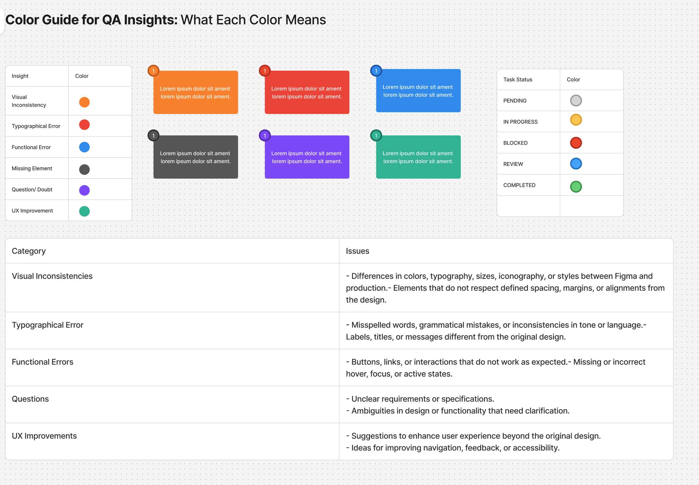
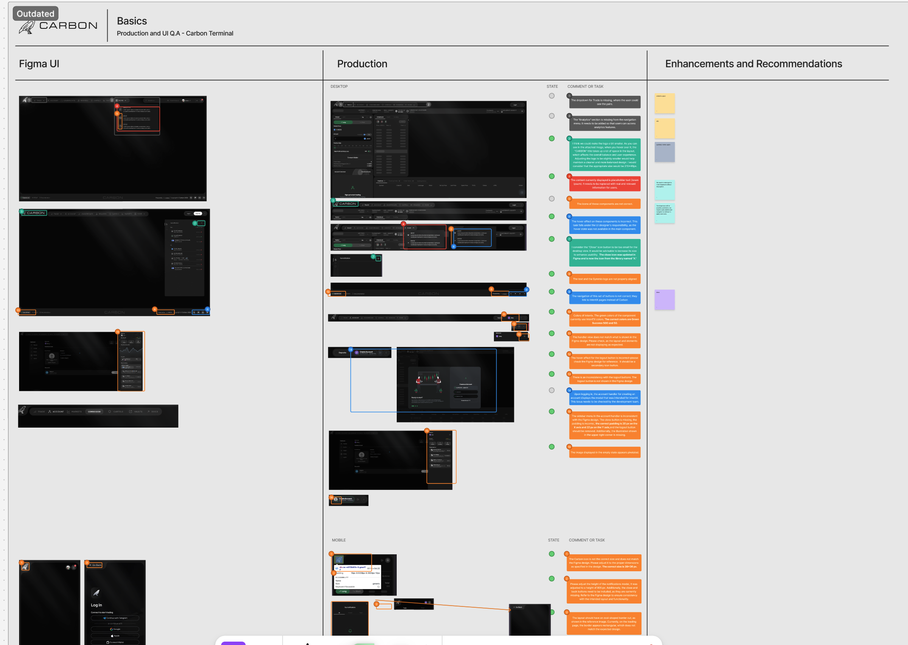
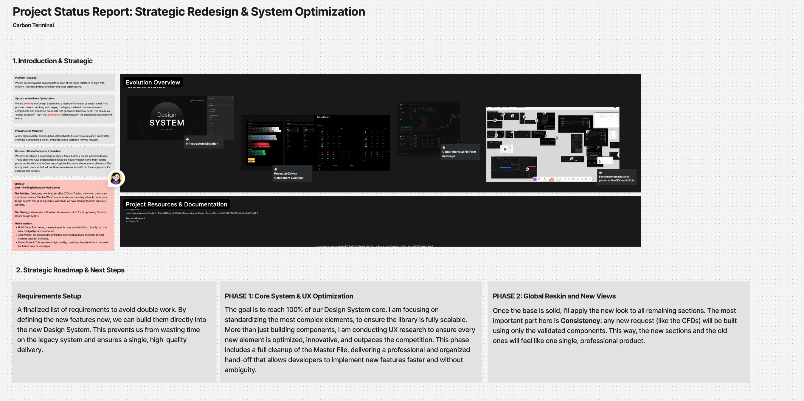

# Carbon — material de trabajo compartido por Dany

Fecha: 26 de octubre de 2026.

[Volver a la ficha del caso](../carbon.md) · [Método de trabajo transversal](../../../estrategia/metodo-de-trabajo.md)

Dany indica que creó la estructura de trabajo en Figma y realizó la auditoría y el research para un reskin durante 2026, con apoyo de IA para generar ideas y explorar posibles mejoras. También aclara que este tipo de prácticas se realizaba en otros productos. Estas capturas documentan el ejemplo de Carbon.

Se conservan los siete adjuntos originales. Los repetidos se identifican cuando son idénticos; no se cuentan como evidencias diferentes. Se guardan como material de preparación del caso, separado de la galería de inspiración del portfolio. La selección para publicar sigue pendiente.

## Qué permiten documentar

- **QA estructurado:** comparación Figma/producción, comentarios numerados, categorías de incidencias y estados separados.
- **Auditoría y benchmarking:** hallazgos, referencias y oportunidades propuestas; no equivalen por sí solos a investigación con usuarios.
- **Planificación de evolución:** etapas por sección, requisitos, sistema de diseño y reskin.
- **IA en el proceso:** la participación de IA procede del relato de Dany; las capturas no detallan todavía las consultas ni las decisiones que tomó a partir de ellas.

## Cómo leer el estado del trabajo

**Aclaración posterior de Dany, 26 de octubre:** el cliente aprobó casi todo el reskin global y gran parte de ese trabajo llegó a producción. Esta confirmación aporta el estado general; las capturas de planificación se siguen leyendo según su fecha y falta relacionar cambios específicos con la versión publicada.

- La guía distingue tipos de observación —inconsistencia visual, error de texto, error funcional, elemento ausente, duda y mejora UX— y estados —pendiente, en progreso, bloqueado, revisión y completado—. Los colores de categoría no se interpretan como severidad.
- Algunas capturas tienen la marca Outdated: describen una etapa del trabajo, no necesariamente el producto actual.
- Los beneficios del rediseño, la meta de completar el núcleo del sistema y los tiempos de 14 a 18 días aparecen como objetivos o planificación, no como resultados medidos.
- El apartado User Access Insights y las referencias a UX research requieren explicar las fuentes y el método antes de atribuir entrevistas, analítica o pruebas con usuarios.

## Capturas

### Guía de categorías y estados de QA

Clasificación de incidencias, plantillas numeradas y estados de seguimiento.

### Comparación Figma y producción

Capturas comparadas, anotaciones, estados y recomendaciones en desktop y móvil. La captura está marcada Outdated.

### Plan por secciones para el reskin

Metodología, etapas y entregables propuestos; incluye una estimación de 14 a 18 días, no un plazo cumplido.

### Auditoría de producto y benchmarking

Problemas actuales, propuestas, beneficios esperados y referencias organizadas por secciones.

### Reporte de estado y evolución del sistema

Resumen de evolución, recursos, requisitos y hoja de ruta. Las fases futuras no se dan por ejecutadas.

### Comparación Figma y producción — segundo adjunto

Segunda captura compartida de la comparación de QA.

Adjunto idéntico a [02-reporte-figma-produccion.png](materiales/02-reporte-figma-produccion.png). Se conserva el original adicional.

### Guía de QA — segundo adjunto

Segunda captura compartida de la guía de categorías y estados.

Adjunto idéntico a [01-guia-categorias-estados-qa.png](materiales/01-guia-categorias-estados-qa.png). Se conserva el original adicional.

