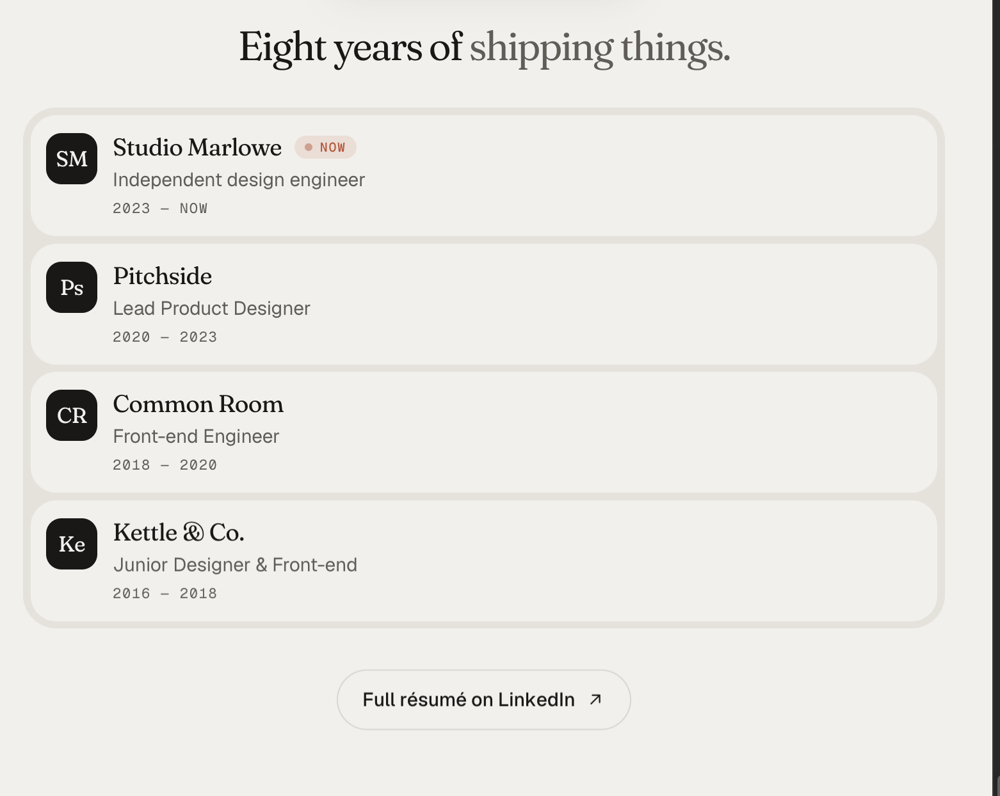

# Mi trayectoria — propuesta de contenido

Estado: incorporación, formato y selección confirmados, 26 de octubre de 2026. Conservar empresa, cargo y fechas, sin los párrafos de responsabilidades. Dany aceptó mostrar las tres experiencias más recientes y desplegar el resto dentro de la web mediante «Ver trayectoria completa». El diseño visual sigue abierto.

## Qué aporta y dónde encaja

Ayuda a los equipos que contratan a entender dónde ha trabajado Dany, en qué roles y durante qué periodos. Se propone un bloque compacto junto a «Sobre mí», después de su presentación personal. Los proyectos seleccionados muestran su trabajo; esta parte resume su recorrido profesional.

## Contenido recomendado

- Título: **Mi trayectoria**.
- Ocho entradas breves: empresa, rol y periodo. Logo opcional.
- Mostrar inicialmente Esthetiqo Studio, Indexceed y edunam. «Ver trayectoria completa» despliega Global Logistics Group LLC, Invita, Duxura Health, Holis y GaluApps dentro de la web. Es un control distinto del enlace a LinkedIn.
- Para la vista breve, usar los años tal como se recogen en la portada. Los meses permanecen documentados en la tabla de fuentes.
- Acceso al perfil de LinkedIn y al CV actualizado.
- Sin repetir las tareas y descripciones extensas de los casos.

No convertir Carbon, Sozialens o PortalFi en empleadores sin confirmar la relación laboral. No usar la cifra de ocho años ni las empresas o cargos de la referencia.

## Datos por confirmar

**Identidad confirmada por Dany:** Esthetiqo Studio y Quantiqo son la misma empresa. Se registran como una sola experiencia. Para el texto público se toma «Esthetiqo Studio», como aparece en su CV y captura de LinkedIn. No se ha establecido cuál de los nombres fue anterior ni si hubo un rebranding; no afirmarlo. El cargo mostrado es «Lead Product Designer & UX/UI Systems» y el periodo, agosto de 2023 a agosto de 2026.

La captura de experiencia laboral amplía el CV con las siguientes ocho entradas, incluidas en la selección aceptada:

| Empresa | Cargo mostrado | Periodo mostrado |
| --- | --- | --- |
| Esthetiqo Studio | Lead Product Designer & UX/UI Systems | ago. 2023 – ago. 2026 |
| Indexceed | Product Designer & UX Specialist | abr. 2023 – may. 2023 |
| edunam | Product Designer | ene. 2023 |
| Global Logistics Group LLC | Product Designer | ago. 2022 – dic. 2022 |
| Invita | UI Designer | abr. 2022 – jun. 2022 |
| Duxura Health | UI Designer | ene. 2022 – jun. 2022 |
| Holis | UI Designer | nov. 2021 – ene. 2022 |
| GaluApps | Visual Designer | jul. 2019 – mar. 2021 |

La cifra total de años de experiencia sigue pendiente; no sumar duraciones solapadas. La captura indica «Presencial» para Esthetiqo, mientras que Dany describe trabajo remoto: no añadir modalidad a la sección ni resolver esta diferencia por suposición.

Fuente conservada aparte de las referencias visuales: [captura de experiencia laboral](materiales/trayectoria/experiencia-linkedin-2026-10-26.png). Las descripciones extensas de la captura no se incorporan al bloque breve.

## Referencia

Tomamos como idea la lectura rápida de empresa, rol y fechas. El diseño de tarjetas, tipografía y composición siguen abiertos.

## Criterio de cierre

La selección de ocho experiencias y la presentación de tres entradas iniciales con despliegue están aceptadas. Quedan por diseñar la composición y los estados del control, incluyendo la forma de contraer la lista y su uso con teclado. La ubicación junto a Sobre mí sigue siendo la propuesta de estructura.
