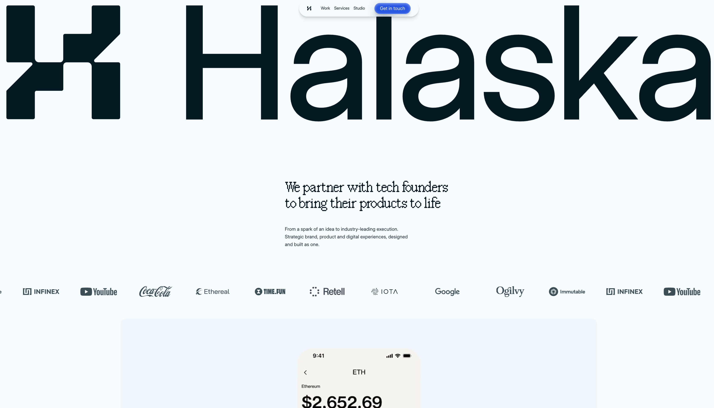
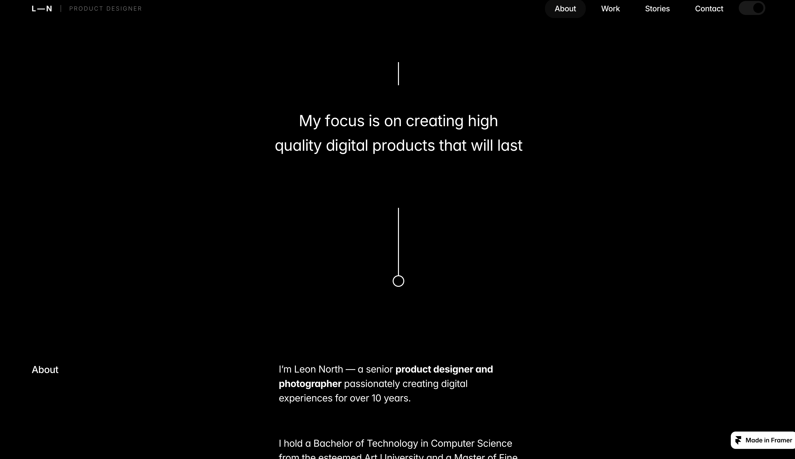
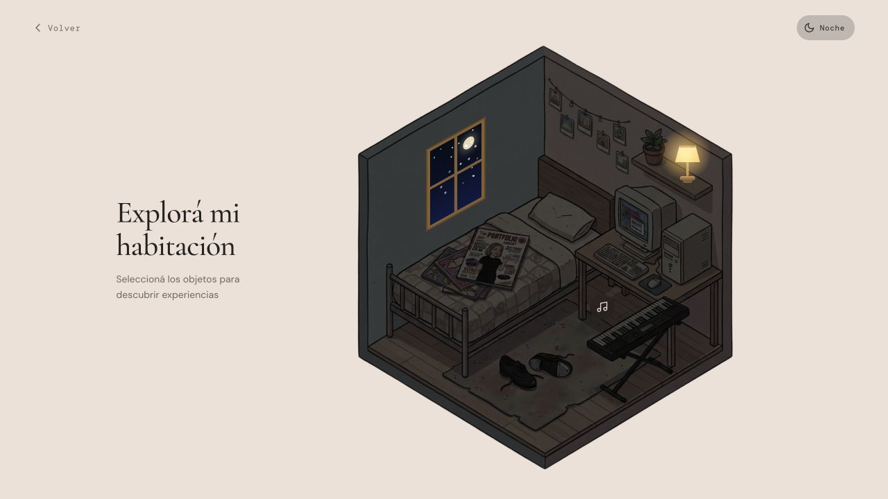
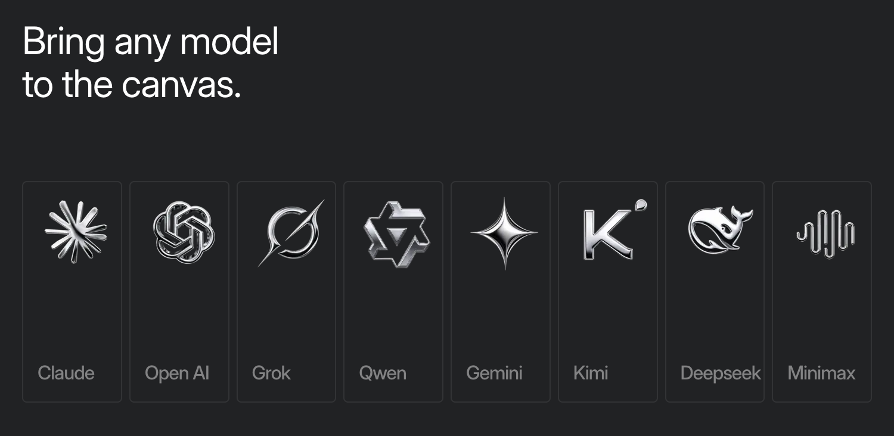
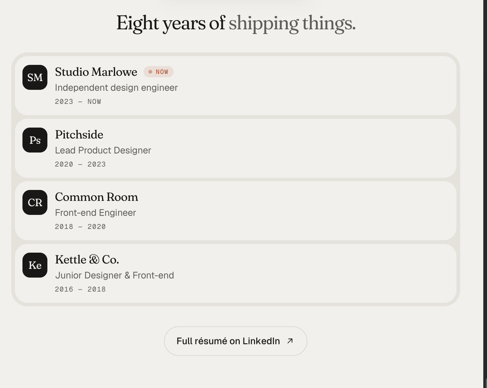

# Referencias visuales compartidas por Dany

Recopilación inicial: 23 de octubre de 2026. Actualizada: 26 de octubre de 2026.

Estas imágenes son inspiración, no diseños aprobados ni material propio de los proyectos de Dany. Se conservaron copias locales de los originales compartidos para que no dependan de las carpetas temporales. El CV y las muestras de producto se mantienen separados de esta galería.

**Orden vigente:** primero ideas, información y textos. Retomar diseño y generación de imágenes cuando Dany lo solicite.

[Volver al documento de trabajo](../estrategia/documento-de-trabajo.md)

## Índice

- [Hero — Halaska](#01-hero-halaska)
- [Hero — Nina Park](#02-hero-nina-park)
- [Presentación — Leon North](#03-presentacion-leon-north)
- [Hero — Leo Marlowe](#04-hero-leo-marlowe)
- [Hero — Marcus Presse](#05-hero-marcus-presse)
- [Hero — Zara Miller](#06-hero-zara-miller)
- [Persona trabajando en una pradera](#07-escritorio-en-pradera)
- [Paisajes y ondas de color](#08-paisajes-ondas-color)
- [Laptop, flores y composiciones web](#09-laptop-flores-referencias)
- [Persona en una colina con ondas de color](#10-colina-ondas-color)
- [Computadora retro entre flores](#11-computadora-retro-naturaleza)
- [Persona de espaldas trabajando en un paisaje](#12-persona-pc-paisaje)
- [Laptop abierta en una pradera](#13-laptop-pradera)
- [Paisajes y composición de contacto](#14-paisaje-contacto)
- [Propuesta previa de Gemini](#15-propuesta-previa-gemini)

- [Herramientas — tarjetas con logos y nombres](#16-herramientas-tarjetas-logos)

- [Trayectoria — empresas, roles y periodos](#17-trayectoria-experiencia)

## Hero — Halaska

## Hero — Nina Park

## Presentación — Leon North

## Hero — Leo Marlowe

## Hero — Marcus Presse

## Hero — Zara Miller

## Persona trabajando en una pradera

## Paisajes y ondas de color

## Laptop, flores y composiciones web

## Persona en una colina con ondas de color

## Computadora retro entre flores

## Persona de espaldas trabajando en un paisaje

## Laptop abierta en una pradera

## Paisajes y composición de contacto

## Propuesta previa de Gemini

Antecedente para revisar, no dirección aprobada. Sus métricas y capacidades no se atribuyen a Dany.

## Captura adicional de revisión

Captura tomada durante la revisión de Victoria; no es un adjunto enviado por Dany.

## Herramientas — tarjetas con logos y nombres

Referencia compartida el 26 de octubre. Interesan la fila de tarjetas, el tamaño de los logos y los nombres en la parte inferior. La lista de modelos y el texto de la imagen no representan las herramientas de Dany. El acabado oscuro y metálico es inspiración, no una decisión de estilo cerrada.

## Trayectoria — empresas, roles y periodos

Referencia compartida el 26 de octubre. Interesan el resumen de experiencia con empresa, rol y periodo, y el acceso al perfil profesional. Los nombres, cargos y ocho años de la captura pertenecen a la referencia y no se atribuyen a Dany.

